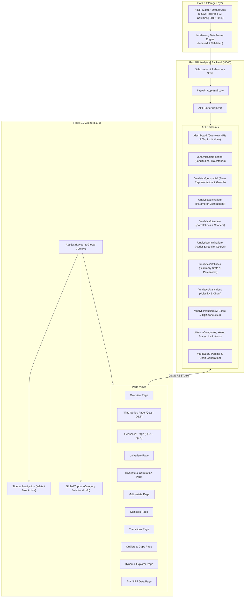

# NIRF Analytics Dashboard — Project Architecture

**Version:** 1.0.0  
**Platform:** DHV Analytical Platform  
**Target Environment:** FastAPI (Python 3.11+) + React 19 Client (Vite 8)  
**Dataset Reference:** `data/Processed/NIRF_Master_Dataset.csv` (6,572 verified records, 2017–2025)

---

## 1. Executive Architecture Overview

The NIRF Analytics Dashboard is an institutional intelligence platform engineered to explore, analyze, and visualize nine cycles (2017–2025) of official National Institutional Ranking Framework (NIRF) rankings published by the Ministry of Education, Government of India.

The platform follows a decoupled, high-performance client-server architecture:
- **Backend Core**: FastAPI (asynchronous ASGI framework), Pandas, NumPy, SciPy, and Scikit-learn for high-speed statistical transformations, longitudinal tracking, and query generation.
- **Frontend Presentation**: Modern React 19 single-page application (SPA) bundled with Vite, styled with a clean corporate design system (white sidebar, blue active accents, subtle borders/shadows, dark navy headings) matching the DHV Analytical Platform reference design.
- **Visualization Engine**: Plotly.js rendered through interactive React components, delivering responsive, publication-quality analytical graphics with synced hover states, zoom/pan controls, and responsive sizing.



---

## 2. Directory & Workspace Layout

```
NIRF_DASHBOARD/
├── backend/
│   ├── app/
│   │   ├── api/
│   │   │   ├── routes/
│   │   │   │   ├── analytics.py           # Statistical, longitudinal, and correlation endpoints
│   │   │   │   ├── dashboard.py           # Executive overview KPIs and top-ranked entities
│   │   │   │   ├── filters.py             # Category, year, state, and institution metadata
│   │   │   │   ├── institutions.py        # Deep dive by Institute ID / institution name
│   │   │   │   └── nlq.py                 # Natural Language Query execution
│   │   │   ├── __init__.py
│   │   ├── core/
│   │   │   ├── config.py                  # Pydantic Settings, CORS, dataset paths
│   │   │   ├── database.py                # Dataset singleton lifecycle & memory indexing
│   │   │   └── __init__.py
│   │   ├── nlq/
│   │   │   ├── query_builder.py           # Translates extracted intent into Pandas queries
│   │   │   ├── query_parser.py            # Rule-based / NLP token matching for NIRF metrics
│   │   │   ├── visualization_selector.py  # Selects optimal chart configuration
│   │   │   └── __init__.py
│   │   ├── schemas/
│   │   │   ├── filters.py                 # Request validation schemas for multi-filters
│   │   │   ├── responses.py               # Pydantic models for KPIs, charts, and tables
│   │   │   └── __init__.py
│   │   ├── services/
│   │   │   ├── analytics/
│   │   │   │   ├── bivariate.py           # TLR vs RPC, Spearman/Pearson correlation matrices
│   │   │   │   ├── distribution.py        # Histogram bins, KDE, skewness, kurtosis
│   │   │   │   ├── geospatial.py          # State counts, concentration ratios, newly appearing
│   │   │   │   ├── multivariate.py        # Radar charts, 5-parameter spider profiles
│   │   │   │   ├── outlier_detection.py   # IQR and Z-score outlier detection algorithms
│   │   │   │   ├── ranking_transitions.py # Rank jump/drop calculation, volatility index
│   │   │   │   ├── time_series.py         # Multi-year trajectories, improvements, declines
│   │   │   │   ├── univariate.py          # Boxplots, quartile stats, parametric distributions
│   │   │   │   └── __init__.py
│   │   │   ├── chart_service.py           # Standardized Plotly figure JSON generation
│   │   │   ├── data_loader.py             # Safe, read-only ingestion of master CSV
│   │   │   ├── data_validator.py          # Integrity guards, type casting, category masks
│   │   │   ├── filter_service.py          # Fast faceted filtering engine
│   │   │   └── __init__.py
│   │   ├── utils/
│   │   │   ├── constants.py               # Parameter names, category maps, color hexes
│   │   │   ├── helpers.py                 # Number formatters, rank normalizers, tie checkers
│   │   │   └── __init__.py
│   │   ├── main.py                        # FastAPI instantiation, middleware, lifespan hooks
│   │   └── __init__.py
│   ├── venv/                              # Python 3.11+ virtual environment
│   ├── .env.example
│   └── requirements.txt                   # Verified pinned package requirements
│
├── data/
│   ├── Processed/
│   │   ├── NIRF_Master_Dataset.csv        # Definitive unified analytical dataset (6,572 rows)
│   │   ├── master_dataset_schema.json     # Formal JSON schema definition
│   │   ├── master_dataset_summary.csv     # Precalculated column statistics
│   │   ├── record_count_investigation.csv # Reconciliation analysis
│   │   └── validation/                    # Validation audit logs and comparison matrices
│   └── Raw/                               # Read-only scraping source archives (DO NOT MODIFY)
│
├── docs/
│   ├── analytics_documentation.md         # Formulae, algorithms, and analytical tabs
│   ├── data_dictionary.md                 # Column schemas, mappings, and data rules
│   └── project_architecture.md            # This document
│
├── frontend/
│   ├── public/                            # Static assets and icons
│   ├── src/
│   │   ├── assets/                        # Logos and branding SVGs
│   │   ├── components/
│   │   │   ├── analytics/                 # Tab bars, sub-filter toolbars, analytical cards
│   │   │   ├── charts/                    # Reusable Plotly chart wrapper with resize observer
│   │   │   ├── common/                    # Badges, loaders, error boundaries, tooltips
│   │   │   ├── dashboard/                 # KPI metric cards, Top 10 data table
│   │   │   ├── filters/                   # Category selector dropdown, year sliders
│   │   │   └── layout/                    # Sidebar, Header, PageContainer, TabBar
│   │   ├── hooks/
│   │   │   ├── useDataset.js              # Fetching and caching analytical queries
│   │   │   └── useFilters.js              # Active category, year, and selection context
│   │   ├── pages/
│   │   │   ├── Bivariate.jsx              # Bivariate & Correlation Page
│   │   │   ├── Dashboard.jsx              # Executive Overview Page
│   │   │   ├── Distribution.jsx           # Distribution Explorer
│   │   │   ├── Geospatial.jsx             # Geospatial & State Analysis (Q2.1 - Q2.5)
│   │   │   ├── Multivariate.jsx           # Multivariate Radar & Parallel Coordinates
│   │   │   ├── NaturalLanguageQuery.jsx   # Ask NIRF Data Interface
│   │   │   ├── OutlierDetection.jsx       # Outliers & Gaps Page
│   │   │   ├── RankingTransitions.jsx     # Rank Volatility & Transitions
│   │   │   ├── TimeSeries.jsx             # Time-Series & Trend Analysis (Q1.1 - Q1.5)
│   │   │   └── Univariate.jsx             # Univariate Parameter Analysis
│   │   ├── services/
│   │   │   └── api.js                     # Centralized Axios / Fetch HTTP client
│   │   ├── styles/                        # Design system tokens, variables, typography
│   │   ├── utils/
│   │   │   ├── chartHelpers.js            # Plotly layout generator matching reference style
│   │   │   └── formatters.js              # Decimal, percentage, rank, and score formatters
│   │   ├── App.css
│   │   ├── App.jsx                        # Routing, sidebar navigation, view orchestrator
│   │   ├── index.css                      # Global Tailwind / design reset
│   │   └── main.jsx                       # React 19 root mounting
│   ├── package.json
│   ├── vite.config.js
│   └── README.md
│
├── scripts/
│   ├── run_backend.ps1                    # PowerShell backend launcher (Uvicorn)
│   └── run_frontend.ps1                   # PowerShell frontend launcher (Vite dev)
│
└── tests/
    ├── backend/                           # Pytest unit tests for analytics modules
    └── frontend/                          # Component and routing tests
```

---

## 3. Backend Architecture & Engine Design

### 3.1 Dataset Ingestion & In-Memory Store
To eliminate repetitive disk I/O and optimize multi-user concurrency:
- The dataset `data/Processed/NIRF_Master_Dataset.csv` is loaded upon FastAPI application startup (`lifespan` handler) using `data_loader.py`.
- In-memory DataFrame is normalized with appropriate types (`year: int`, `rank: int`, `overall_score: float`, parameter scores: `float`).
- A multi-index (`[category, year]`, `[institute_id]`, `[state]`) enables sub-millisecond filtering.
- Category availability masks prevent queries against categories in years where they were not surveyed (e.g., Agriculture before 2023).

### 3.2 Analytics Service Layer Architecture
All heavy analytical calculations are computed on the backend to maintain consistency and enable caching:
- **`time_series.py`**:
  - `get_trajectory(institution_id, category)`: Computes multi-year rank and score series (2017–2025).
  - `get_top_improvers(category, start_year, end_year, top_n)`: Computes $\Delta \text{Rank} = \text{Rank}_{\text{start}} - \text{Rank}_{\text{end}}$.
  - `get_top_decliners(category, start_year, end_year, top_n)`: Computes biggest rank regressions.
  - `get_average_score_trend(category)`: Computes yearly mean, median, IQR across cycles.
  - `get_consistent_top(category, threshold_rank, min_appearances)`: Identifies benchmark institutions that never dropped out.
- **`geospatial.py`**:
  - `get_top_states(year, category, top_n)`: State-wise tally of Top-100 institutions.
  - `get_state_distribution_trend(category)`: Multi-year state representation stacked matrix.
  - `get_state_growth(category, base_year, target_year)`: Net percentage growth in institutions per state.
  - `compare_states(state_a, state_b, category, year)`: Direct head-to-head parameter comparison.
  - `get_newly_appearing_states(category)`: Historical debut years of states entering top rankings.
- **`univariate.py` & `distribution.py`**:
  - Computes distribution histograms, bin edges, KDE approximation, skewness, kurtosis, and Tukey 5-number summaries.
- **`bivariate.py`**:
  - Pairwise Pearson and Spearman correlation coefficients.
  - Scatter plot data points with trendline regression coefficients ($R^2$, slope, intercept).
- **`multivariate.py`**:
  - Polar radar profile data for individual institutions vs category benchmark means across `[TLR, RPC, GO, OI, PR]`.
- **`ranking_transitions.py`**:
  - Churn rate, rank volatility index, transition probability across quartiles (Ranks 1–25, 26–50, 51–75, 76–100).
- **`outlier_detection.py`**:
  - Identifies institutions exceeding $1.5 \times \text{IQR}$ or $|Z| > 2.5$ in score vs rank, or parameter imbalances (e.g. exceptionally high research with low perception).

### 3.3 Natural Language Query (NLQ) Engine
The `nlq/` package provides rule-based parsing and intent classification:
- Recognizes query types:
  - *Entity Trajectory*: "How did IIT Bombay perform over the years in Engineering?"
  - *State Aggregation*: "Which state has the most medical colleges in 2024?"
  - *Correlation / Comparison*: "Compare TLR vs RPC in Overall category for 2025."
  - *Improvers / Decliners*: "Top 5 most improved management colleges between 2020 and 2025."
- Translates extracted entities and metrics into structured queries executed by `query_builder.py`.
- `visualization_selector.py` pairs the result with the optimal visualization layout (Line chart, Bar chart, Scatter plot, or Data table).

---

## 4. Frontend Architecture & Design System

### 4.1 Design System Specifications (from Reference Screenshots)

The user interface adheres strictly to the DHV Analytical Platform design specifications:

| Element | Specification | Hex / Token |
| :--- | :--- | :--- |
| **Sidebar Background** | Clean white with subtle right border | `#FFFFFF`, border `#E2E8F0` |
| **Sidebar Active Item** | Soft blue pill with blue accent indicator & bold text | Background `#EFF6FF`, Border `#2563EB`, Text `#1D4ED8` |
| **Sidebar Inactive Item** | Neutral slate text with smooth hover pill | Text `#64748B`, Hover `#F1F5F9` |
| **Page Background** | Subtle cool gray-blue background | `#F8FAFC` (or `#F3F6FC`) |
| **Card Styling** | Pure white, crisp 1px border, subtle ambient drop shadow | Background `#FFFFFF`, Border `#E2E8F0`, Shadow `0 1px 3px rgba(0,0,0,0.05)` |
| **Headings & Titles** | High-contrast dark navy typography | `#0F172A` (Navy slate) |
| **Body / Subtitles** | Muted slate text for secondary explanations | `#64748B` |
| **Primary Blue Chart Color**| Clean vibrant royal blue for bars and trajectory lines | `#2563EB` |
| **Secondary Accents** | Emerald (Pan-India), Amber (Years), Purple (Disciplines) | Emerald `#10B981`, Amber `#F59E0B`, Purple `#8B5CF6` |
| **Active Analytical Tab** | Outlined pill button with subtle blue background | Border `#2563EB`, Background `#EFF6FF`, Text `#2563EB` |
| **Inactive Analytical Tab**| Flat pill button with subtle hover | Border `#E2E8F0`, Text `#64748B`, Hover `#F8FAFC` |
| **Data Tables** | Compact tabular rows, zebra hovering, numeric right-aligned | Header `#F8FAFC`, Border `#E2E8F0`, Rank Badges `#EFF6FF` |

### 4.2 Application Navigation Structure

```
DASHBOARD
  └── Overview (Executive summary KPIs, Top 10 institutions table, Score distribution histogram)

ANALYTICS
  ├── Time-Series (Q1.1 – Q1.5 Trajectories, Improvements, Declines, Average Trend, Consistency)
  ├── Geospatial (Q2.1 – Q2.5 Top States, Distribution Trend, State Growth, Comparison, Newly Appearing)
  ├── Univariate (Q3.1 – Q3.5 Score Distribution, Rank Distribution, Descriptive Stats, Quartiles, Category Spread)
  ├── Bivariate (Q4.1 – Q4.5 RPC vs Overall, PR vs Overall, Correlation Hierarchy, TLR vs RPC, Historical Stability)
  ├── Multivariate (Q5.1 – Q5.5 Top 5 Radar, Research vs Teaching, Perception Gaps, Trade-offs, Parallel Coordinates)
  ├── Statistics (Q6.1 – Q6.5 Top 10 vs Remaining, Dispersion Trends, Parameter Variability, Median/IQR, State Distributions)
  ├── Transitions (Q7.1 – Q7.5 Rank Band Shifts, Top 10 Turnover, Band Retention Matrix, Mobility Rates)
  └── Outliers & Gaps (Q8.1 – Q8.5 Research Outliers, RPC vs TLR Gaps, Annual Jumps/Drops, Volatility Analysis)

INTELLIGENCE
  ├── Dynamic Explorer (Faceted Slicing, Variable Mapping, 14 Chart Types, Recommender, CSV/PNG Export)
  └── Ask NIRF Data (Natural Language Query Interface with Deterministic Parsing & Inline Plotly Visualizations)
  │     ├── Q2.1 Top States (State-wise count of top-ranked institutions)
  │     ├── Q2.2 Distribution Trend (Multi-year state representation shifts)
  │     ├── Q2.3 State Growth (Net state institution count changes)
  │     ├── Q2.4 Compare States (Head-to-head state metric comparison)
  │     └── Q2.5 Newly Appearing (Debut of emerging states in rankings)
  ├── Univariate (Parameter score distributions, boxplots, histograms, Tukey summaries)
  ├── Bivariate & Corr (TLR vs RPC, Score vs Rank scatters, Pearson/Spearman matrix)
  ├── Multivariate (5-parameter institutional radar charts, spider overlays)
  ├── Statistics (Parametric & non-parametric statistics, percentile rankings)
  ├── Transitions (Rank jump matrix, transition probabilities, volatility index)
  └── Outliers & Gaps (Anomalies, score cliffs, disproportionate parameter drivers)

INTELLIGENCE
  ├── Dynamic Explorer (Multi-attribute faceted filter grid, custom cohort analysis)
  └── Ask NIRF Data (Natural language query input, automated chart recommendation)
```

---

## 5. API Design & Endpoints Specification

All endpoints are prefixed with `/api/v1` and accept query parameters for category and year scoping.

### 5.1 Metadata & Filtering Endpoints
- `GET /api/v1/filters/metadata`
  - Returns available categories, year spans per category, available states, and total record counts.
- `GET /api/v1/filters/institutions?category={cat}&year={yr}`
  - Returns list of institutions (`{id, name, city, state}`) available in the selected category and year.

### 5.2 Dashboard Endpoints
- `GET /api/v1/dashboard/overview?category={cat}&year={yr}`
  - Returns executive KPIs (`total_records`, `unique_institutions`, `states_count`, `years_span`, `categories_count`), Top 10 institutions list with parameter breakdowns, and score distribution histogram bins.

### 5.3 Time-Series Endpoints
- `GET /api/v1/analytics/time-series/trajectory?institution_id={id}&category={cat}`
  - Returns yearly ranking, overall score, and parameter values (2017–2025) for the selected institution.
- `GET /api/v1/analytics/time-series/improvers?category={cat}&start_year={yr1}&end_year={yr2}&limit=10`
  - Returns top institutions with highest positive rank movement.
- `GET /api/v1/analytics/time-series/decliners?category={cat}&start_year={yr1}&end_year={yr2}&limit=10`
  - Returns institutions with highest negative rank movement.
- `GET /api/v1/analytics/time-series/average-trend?category={cat}`
  - Returns yearly average score, median, 25th, and 75th percentiles.
- `GET /api/v1/analytics/time-series/consistent-top?category={cat}&threshold=25`
  - Returns institutions consistently ranked within the top threshold across all cycles.

### 5.4 Geospatial Endpoints
- `GET /api/v1/analytics/geospatial/top-states?category={cat}&year={yr}&limit=15`
  - Returns top states sorted by number of ranked institutions, leading state, total states represented, and top-3 concentration ratio.
- `GET /api/v1/analytics/geospatial/distribution-trend?category={cat}`
  - Returns yearly breakdown of institution counts per state.
- `GET /api/v1/analytics/geospatial/state-growth?category={cat}&base_year={yr1}&target_year={yr2}`
  - Returns growth rates and delta institution counts per state.
- `GET /api/v1/analytics/geospatial/compare-states?state_a={s1}&state_b={s2}&category={cat}&year={yr}`
  - Returns side-by-side metric comparison between two states.
- `GET /api/v1/analytics/geospatial/newly-appearing?category={cat}`
  - Returns states newly appearing in rankings and their debut years.

### 5.5 Advanced Analytical Endpoints
- `GET /api/v1/analytics/univariate/summary?category={cat}&year={yr}&parameter={param}`
- `GET /api/v1/analytics/bivariate/correlation-matrix?category={cat}&year={yr}`
- `GET /api/v1/analytics/bivariate/scatter?category={cat}&year={yr}&x_param={p1}&y_param={p2}`
- `GET /api/v1/analytics/multivariate/radar?category={cat}&year={yr}&institution_ids={id1,id2}`
- `GET /api/v1/analytics/statistics/summary-table?category={cat}&year={yr}`
- `GET /api/v1/analytics/transitions/volatility?category={cat}`
- `GET /api/v1/analytics/outliers/detect?category={cat}&year={yr}&method={iqr|zscore}`
- `POST /api/v1/nlq/query` (Body: `{ "query": "..." }`)

---

## 6. Security, Reliability & Data Integrity Guardrails

1. **Read-Only Data Access**: The master dataset `NIRF_Master_Dataset.csv` is loaded strictly in read-only mode. No API endpoint modifies the file.
2. **Category-Year Availability Guard**: Every analytics endpoint verifies that the requested category existed in the specified year before executing computations. If unranked or uncomputed, appropriate status flags and friendly messages are returned.
3. **No Synthetic / Mock Data**: All metrics, rankings, and counts are calculated dynamically from ground truth records.
4. **CORS & Origin Isolation**: FastAPI backend configures permissive local CORS (`http://localhost:5173`, `http://127.0.0.1:5173`) to allow seamless local development.
5. **Robust Error Handling**: Pydantic input validation intercepts invalid parameters, returning structured HTTP 422/400 errors with clear diagnostics.

